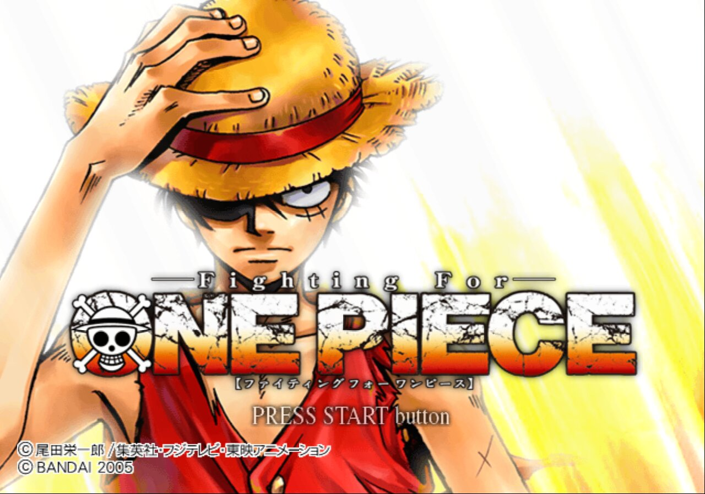

<div align="center">

# FightingForOnePiece_Recomp

**A native Linux port of *Fighting for One Piece* (NTSC-J, `SLPS-25545`), made by statically recompiling the game's PlayStation 2 code to C++.**<br>
Not an emulator: the game's own MIPS R5900 code, rebuilt as a native program on a reimplementation of the PS2 hardware.




<sub>Captured from the running port (640x448, CPU renderer).</sub>

</div>

> [!IMPORTANT]
> No game files are included: no ELF, IRX modules, data archives, or code generated from them.
> You need **your own copy** of the Japanese release, PS2 ID **`SLPS-25545`**. The port is built against that disc's executable:
>
> | File | SHA-1 |
> |---|---|
> | `SLPS_255.45` | `e445f2af578e3780bcd7f59cf57c57b491f3c747` |

## Status

**Bring-up.** Boots to the caution and title screens at 60 Hz with disc reads, textures, palettes and pad input working; movies are skipped. Runtime fixes it needs are on PS2Recomp branches waiting for `main` (see [RECOMP_NOTES.md](RECOMP_NOTES.md)).

| Milestone | |
|---|:---:|
| Map and recompile the main ELF | ✅ |
| Boot: EE kernel, the game's own IOP modules, CD reads from the disc files | ✅ |
| Logos and movies (`MOVIES/*.PSS`) | ⏳ |
| Title screen, menus | 🔧 |
| Music and sound effects | ⏳ |
| Fights | ⏳ |
| Memory card: save and load | ⏳ |

✅ works · 🔧 in progress · ⏳ not reached yet

[RECOMP_NOTES.md](RECOMP_NOTES.md) records how the port is brought up, every fix and how it was found.

## How it works

```
disc files ──► ps2_analyzer (+ Ghidra, hint lists) ──► recomp/ffop.toml
                                  │
                       ps2_recomp ──► C++ (one file per function)
                                  │
                 ELF MPG uploads ──► ps2_vu_aot ──► generated/vu1/
                                  │
   PS2Recomp runtime: EE kernel HLE · DMAC · GIF/GS · VIF/VU0/VU1 ─┼─► ps2EntryRunner
   PS2Recomp IOP:     R3000A interpreter running the game's own IRX · SPU2 · SIO2
```

- The ELF has no symbols. `ps2_analyzer` maps the functions and binds the SCE SDK ones it recognises to the runtime's
  handlers.
- PS2Recomp turns every function into C++. The VU1 microcode found in the ELF is compiled ahead of time by
  `ps2_vu_aot`; microcode loaded from the data archive runs in the interpreter.
- `runtime/ffop_overrides.cpp` holds the game-specific bindings, matched to the ELF by entry point and CRC.

The runtime is the `PS2Recomp/` git submodule: [boubou666/PS2Recomp](https://github.com/boubou666/PS2Recomp), branch
`main`, shared with the *Soulcalibur III*, *Twisted Metal: Black*, *Valkyrie Profile 2: Silmeria*, *The Lord of the
Rings: The Third Age* and *Drakengard* recompilations. The top-level `CMakeLists.txt` builds its runtime, swaps its
placeholder function table for the generated one and links the generated code, `runtime/` and the compiled VU1
microcode into `ps2EntryRunner`. Generic fixes go to boubou666's `main`.

## Requirements

- Linux (developed on Arch)
- CMake 3.21+, Ninja, Clang with C++20, rsync, and bsdtar (libarchive) to extract the disc
- FFmpeg development libraries (`libavcodec`, `libavformat`, `libavutil`, `libswresample`, `libswscale`)
- X11/Wayland and OpenGL development headers (raylib is fetched and built by the runtime)
- Your own copy of `SLPS-25545` as a disc image (the extracted ELF is checked against the hash above)

## Build and run

```bash
git clone --recurse-submodules https://github.com/Arzaroth/FightingForOnePiece_Recomp.git
cd FightingForOnePiece_Recomp
scripts/extract_iso.sh "/path/to/Fighting for One Piece (Japan).iso"   # disc files -> game/
scripts/build_tools.sh                                                  # ps2_recomp, ps2_analyzer, ps2_vu_aot -> build/tools
scripts/recomp.sh                                                       # game/SLPS_255.45 + recomp/ffop.toml -> generated/
scripts/compile_vu1.sh                                                  # VU1 microcode in the ELF -> generated/vu1/
scripts/build_runtime.sh                                                # runtime + generated code -> build/game (RelWithDebInfo)
scripts/run.sh                                                          # ps2EntryRunner game/SLPS_255.45
```

The extracted disc folder is the game's `cdrom0:`; the memory cards (`mc0/`, `mc1/`) are created next to the ELF in
`game/`. `scripts/analyze.sh` reruns `ps2_analyzer` into `build/analyzer.toml`; `recomp/ffop.toml` started from that
output and is edited by hand, so merge new analyzer output into it rather than replacing it.

`JOBS=<n>` sets the build parallelism of every script (default: all cores). `scripts/build_runtime.sh Release` or
`Debug` picks another build type, and `CXX` another compiler (Clang is used when it is installed).
`scripts/ffoprun.sh <name> <seconds> [VAR=value...]` runs the game for that long with a state dump every 5 seconds,
logs to `build/runs/<name>.log` and screenshots the window.

## Disc facts

| | |
|---|---|
| Boot ELF | `SLPS_255.45`, entry `0x10001C`, stripped |
| Video mode | NTSC (`SYSTEM.CNF` `VER = 1.01`) |
| IOP modules | `MODULES/*.IRX`: CDVDSTM, LIBSD, MCMAN, MCSERV, MODHSYN, MODMSIN, PADMAN, SDRDRV, SIO2MAN, SKHSYNTH, SKMSIN, SKSADPCM, SKSOUND, STRADPCM |
| IOP image | `MODULES/IOPRP300.IMG` |
| Data | `FILES.FOA` (256 MiB archive) |
| Movies | `MOVIES/ONEP_OP3.PSS`, `MOVIES/FO_1.PSS` (SCE MPEG-2 PSS) |

## Repository layout

| Path | Contents |
|---|---|
| `PS2Recomp/` | The recompiler and runtime (git submodule, boubou666/PS2Recomp branch `main`) |
| `CMakeLists.txt` | Builds the runtime with the generated code and the game overrides linked in |
| `recomp/` | Recompiler config (`ffop.toml`) and, as the port grows, the function map and entry-point hint lists |
| `runtime/` | Game override module (`ffop_overrides.cpp`) |
| `scripts/` | Build, analyze, recompile, VU1 compile and run scripts; disassembly, IRX and profiling helpers |
| `docs/screenshots/` | Pictures of the running port |
| `RECOMP_NOTES.md` | How the port is brought up, the fixes and the debugging tools |
| `game/`, `generated/`, `build/` | Created by the scripts, ignored by git: disc files, generated C++, builds |

Everything derived from the game (disc files, generated code, builds, logs) stays outside this repository.
Never commit or redistribute it.

## Credits

- [PS2Recomp](https://github.com/ran-j/PS2Recomp) by ran-j and contributors (GPL), the recompiler and runtime this port is built on.
- [boubou666/PS2Recomp](https://github.com/boubou666/PS2Recomp) and the recompilations developed on it; runtime fixes are shared both ways.
- *Fighting for One Piece* © Eiichiro Oda / Shueisha, Toei Animation, Bandai. This is an unofficial fan project, not affiliated with or endorsed by them.
